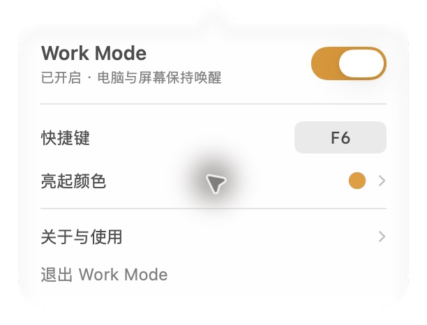

<p align="center"></p>

<h1 align="center">Work Mode</h1>
<p align="center">Keep your Mac awake while AI works.</p>
<p align="center">
  <a href="https://github.com/AnikYang/work-mode/releases/latest/download/Work-Mode-arm64.zip"></a>
</p>
<p align="center"><strong><a href="https://github.com/AnikYang/work-mode/releases/latest/download/Work-Mode-arm64.zip">Download latest version</a></strong> · <a href="https://github.com/AnikYang/work-mode/releases/latest">Release notes & checksums</a></p>
<p align="center">Apple Silicon (M series) · macOS 14+ · Free · MIT licensed</p>
<p align="center"><a href="README.md">简体中文</a> · English</p>

Work Mode is a lightweight macOS menu bar app for long AI tasks. Press **F6** before running a model, generating content, or starting an agent workflow. Your Mac and display stay awake until you toggle Work Mode off.

It repurposes the MacBook's **F6 Do Not Disturb key** as a keep-awake switch. Press the key with the moon symbol directly—no Fn required.

<p align="center"></p>

## Features

- A single menu bar dropdown for the switch, shortcut, active color, about information, and quick help. No standalone settings window.
- A colored sun when enabled and a gray sun when disabled. Choose a preset or any six-digit hex color; the preference persists across launches.
- Prevent idle system sleep and idle display sleep during long AI tasks.
- Take over the built-in Focus key while the default F6 shortcut is selected; restore it when changing shortcuts or quitting normally.
- Record a global shortcut: F1–F20, or a combination with Command, Option, or Control.
- Show a native sun capsule at the top of the display, with Liquid Glass on macOS 26+ and system material on older versions.
- No third-party runtime dependencies, polling, simulated mouse movement, or persistent child processes.
- No account, network connection, telemetry, Accessibility permission, or Input Monitoring permission required.

You enable Work Mode manually; it does not detect AI activity. It replaces the **key's purpose**, not the notification system: it does not silence notifications or change your current Focus state.

## Install and use

**[Download Work-Mode-arm64.zip](https://github.com/AnikYang/work-mode/releases/latest/download/Work-Mode-arm64.zip)**, unzip it, then drag `Work Mode.app` into Applications. Quit the old version before replacing it during an update. This build supports Apple Silicon only, not Intel Macs.

 Distributed builds are ad-hoc signed and are not yet Developer ID signed or notarized. The interface is currently in Simplified Chinese.

1. Open `Work Mode.app`. It starts disabled. Click the sun in the menu bar to open its dropdown.
2. Press the built-in **F6 moon key** to enable Work Mode.
3. Press it again to disable. A colored filled sun means enabled; a gray outlined sun means disabled.
4. Click the shortcut control in the dropdown to record a shortcut. Escape or dismissing the dropdown cancels; “恢复 F6” restores the default.
5. Expand “亮起颜色” to select a preset or enter a `#RRGGBB` value and click “应用”.
6. Expand “关于与使用” for the version, GitHub address, and quick help. “GitHub · Star 支持” opens this repository so you can star the project. “退出 Work Mode” quits, releases sleep assertions, and restores the Focus key.

Color controls and help are collapsed by default. Toggling inside the dropdown updates its status directly; the top capsule appears only when toggling with the dropdown closed.

## Build and test

Use an Apple Silicon Mac running macOS 14+, with the **macOS 26+ SDK** from Xcode 26+ or matching Command Line Tools.

```sh
git clone https://github.com/AnikYang/work-mode.git
cd work-mode
bash scripts/build.sh
bash scripts/test.sh
open "build/Work Mode.app"
bash scripts/package.sh
```

No third-party packages are needed. Packaging creates `build/Work-Mode-arm64.zip` and `build/SHA256SUMS.txt`. Keep these asset names when publishing releases so the README download button always targets the latest version.

Core tests cover color validation and persistence, colored/gray icon rendering, shortcut persistence, registration and conflicts, duplicate events, real power assertions, and mapping restoration logic. They briefly register a test shortcut and power assertions, but do not change real keyboard mappings.

Opt into the real built-in keyboard mapping test on a MacBook desktop session:

```sh
WORKMODE_HARDWARE_TESTS=1 bash scripts/test.sh
```

This temporarily remaps the Focus key and restores the original mappings. Also verify physically that pressing F6 in another app toggles Work Mode without changing Do Not Disturb.

## Scope

- Prevents **automatic idle sleep**. Lid closure, manual sleep, shutdown, and low-battery protection remain controlled by macOS.
- Does not change screen savers, locking policies, connectivity, or AI service limits.
- Focus-key takeover targets the built-in keyboard. External keyboards can use standard F6 or another shortcut.
- After a forced termination, reopen the app and quit normally to restore the mapping. Rebooting also clears temporary mappings.
- Turn Work Mode off when your long-running task finishes.

## Implementation and contributing

SwiftUI and AppKit provide the UI. Carbon handles global shortcuts. IOKit holds `PreventUserIdleSystemSleep` and `PreventUserIdleDisplaySleep` assertions. The keyboard remap uses Apple's [TN2450](https://developer.apple.com/library/archive/technotes/tn2450/) API and preserves existing mappings.

If Work Mode helps you, a **Star** on GitHub helps others discover it.

See [CONTRIBUTING.md](CONTRIBUTING.md). Licensed under the [MIT License](LICENSE).
